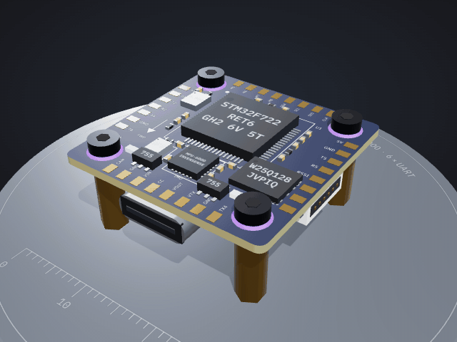
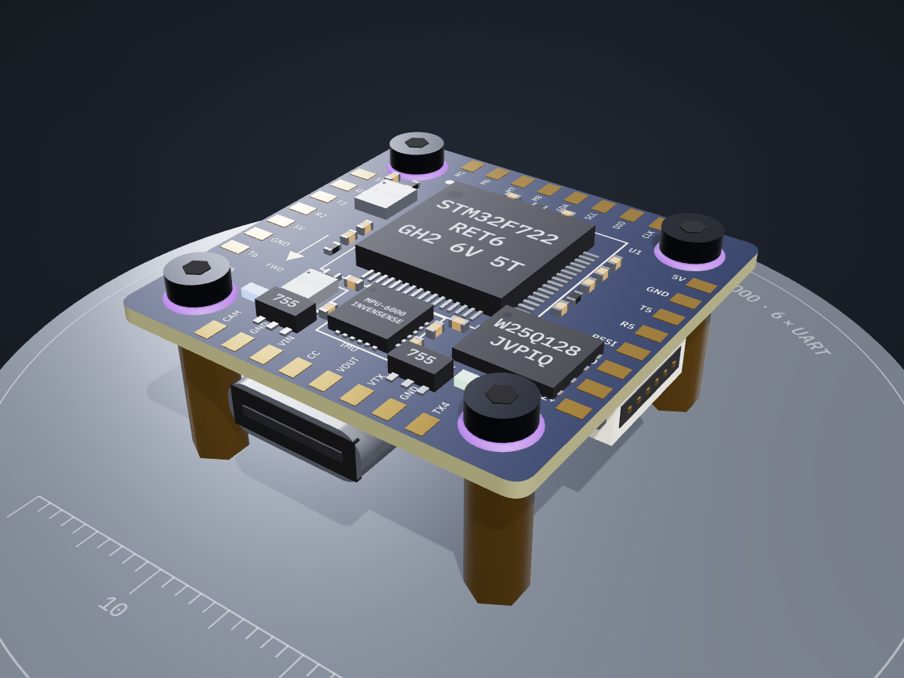
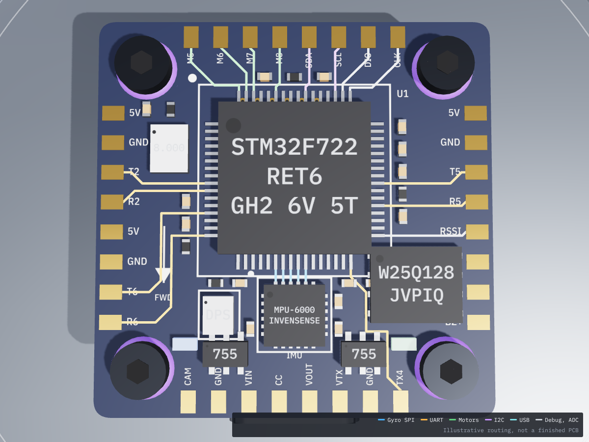
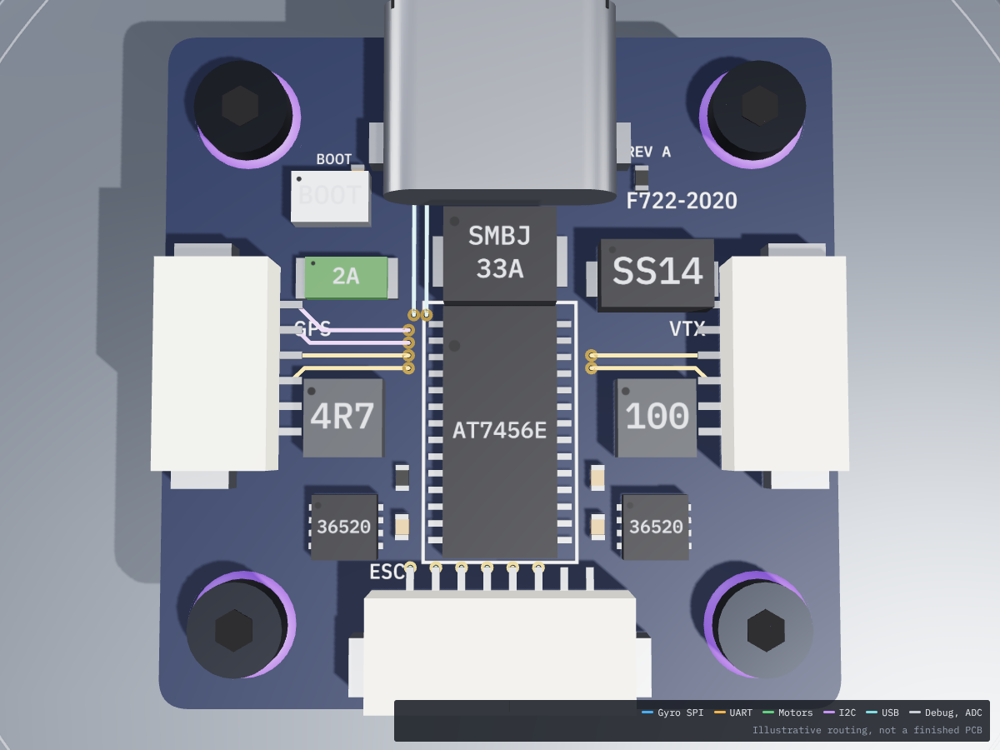
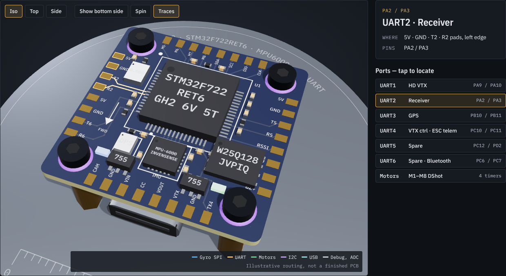

# F722-2020 Flight Controller

  

A 20×20 mm FPV flight controller built around the **STM32F722RET6** and **MPU6000** gyro, designed to pin out every connection an LQFP64 F7 can offer: **6 hardware UARTs, 8 motor outputs**, analog OSD, blackbox flash, barometer and switchable 10 V for an HD VTX.

**[Open the interactive 3D viewer →](https://abhishek22415.github.io/f722-2020-fc/viewer/)** — orbit the board, flip it over, tap any part, locate each UART, and switch on **Traces** to see the signal routing.

## 3D views

| Parts, top side | Signal traces, top side |
| :---: | :---: |
|  |  |
| STM32F722, MPU6000 at the front centre, 16 MB flash, baro, both 3.3 V LDOs and 32 edge pads | Gyro SPI (blue), UARTs (amber), motors (green), I2C (purple), debug and ADC (grey) |

| Signal traces, bottom side | Port locator |
| :---: | :---: |
|  |  |
| ESC, GPS and HD VTX plugs, USB-C, AT7456E OSD and both bucks; traces reach the plugs through vias | Pick a UART and the viewer flips to the right side, highlights its pads and dims every other trace |

The trace routing is illustrative: it shows where each signal goes, not a finished PCB layout.

## Specs

| | |
| --- | --- |
| Board | 26.5 × 26.5 mm, 20 × 20 mm M2 mounting, silicone grommets |
| MCU | STM32F722RET6, Cortex-M7 216 MHz, LQFP64 |
| Gyro | MPU6000 on dedicated SPI1, own low-noise 3.3 V LDO |
| UARTs | UART1 HD VTX · UART2 receiver · UART3 GPS · UART4 SmartAudio / ESC telemetry · UART5 spare · UART6 spare / Bluetooth |
| Motors | 8 DShot outputs on 4 timers (M1–M4 on the ESC plug, M5–M8 on pads) |
| Extras | AT7456E OSD, 16 MB blackbox, DPS310 baro, LED strip, buzzer, camera control, RSSI, current sense |
| Power | 2–6S input, 5 V and 10 V bucks, separate 3.3 V LDOs for MCU and gyro |
| Firmware | Betaflight / INAV |

## Status

**Rev A — design spec, not yet laid out.** A noise and EMI review against datasheets found 15 issues (4 high severity) that must be fixed before PCB layout. See [the review](docs/noise-review.md); the BOM marks every affected part.

## Repository layout

| Path | Contents |
| --- | --- |
| [`docs/design-spec.md`](docs/design-spec.md) | Full Rev A spec: architecture, pin map, UARTs, power tree, gyro notes, connectors, stackup, BOM, bring-up |
| [`docs/noise-review.md`](docs/noise-review.md) | Noise and EMI review: 15 findings, fixes, noise map, bench tests, sources |
| [`hardware/pinout.csv`](hardware/pinout.csv) | MCU pin assignments |
| [`hardware/bom.csv`](hardware/bom.csv) | Main BOM with the review status of each part |
| [`firmware/betaflight/CUSTOMF722_2020.config`](firmware/betaflight/CUSTOMF722_2020.config) | Betaflight starting config (untested) |
| [`viewer/index.html`](viewer/index.html) | Interactive 3D model; open it locally in any browser, or add `#traces` to the URL to start with traces on |
| [`docs/images/`](docs/images) | Renders of the 3D model used in this README |
| [`hardware/kicad/`](hardware/kicad) | Rev B KiCad schematic (importable into Altium), PDF, generator scripts |

## Next steps

1. Apply the review fixes to the spec (Rev B).
2. Draw the schematic and PCB in KiCad from the Rev B spec.
3. Order a prototype run and work through the bench tests in the review.

## Author

Abhishek
