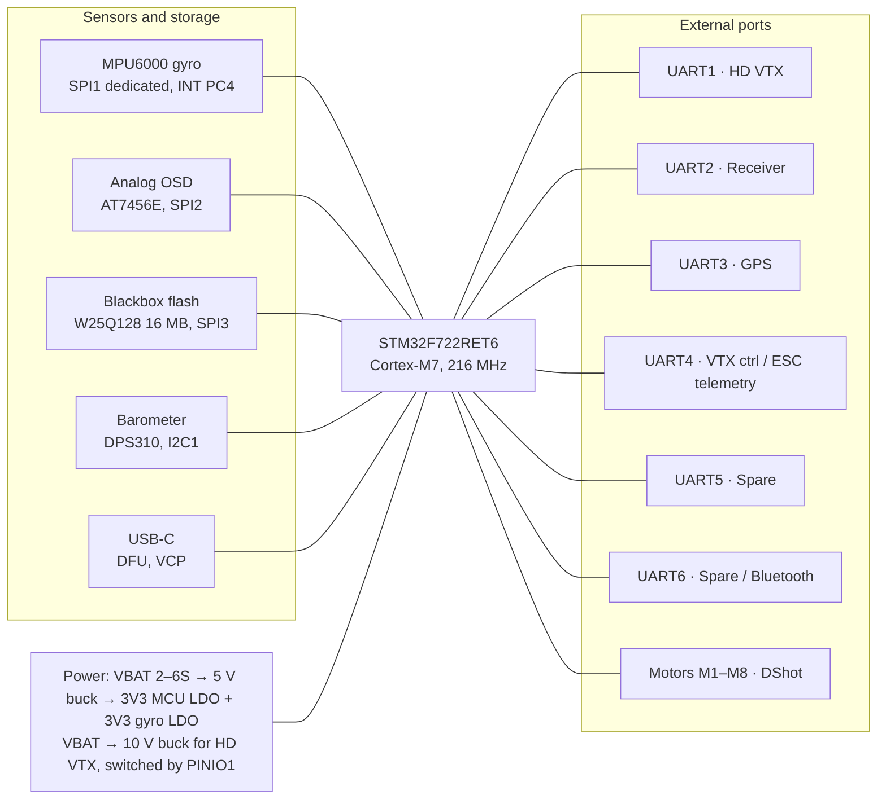

# 20×20 F7 Flight Controller — MPU6000 Design Spec

**Revision A · 27 Oct 2026**

> **Status:** Rev A is the first design pass. The [noise & EMI review](noise-review.md) found 15 issues against it (4 high), including errors in the gyro pin list and the buck regulator choice. Read the review before laying out a PCB from this spec.

## Overview & key specs

The board is an STM32F722RET6 + MPU6000 stack-mount FC on the 20×20 mm pattern, exposing 6 hardware UARTs, 8 motor outputs, I2C, OSD and blackbox — everything an LQFP64 F7 can physically pin out.

| Item | Spec |
| --- | --- |
| Mounting | 20×20 mm hole pattern, Ø2.2 mm holes (M2) with silicone grommets; outline 26.5 × 26.5 mm |
| MCU | STM32F722RET6, Cortex‑M7 @ 216 MHz, 512 KB flash, LQFP64 |
| Gyro / accel | TDK InvenSense MPU6000 on dedicated SPI1, own 3.3 V LDO |
| OSD | AT7456E analog OSD on SPI2 (skip if HD-only build) |
| Blackbox | 16 MB SPI NOR flash (W25Q128JV) on SPI3 |
| Barometer | DPS310 or BMP280 on I2C1 |
| UARTs | 6 hardware (USART1/2/3/6, UART4/5) + USB‑C VCP + soft serial |
| Motor outputs | 8 DShot‑capable (M1–M4 on 8‑pin ESC plug, M5–M8 on pads) |
| Input voltage | 2–6S LiPo (6–26 V nominal), parts rated ≥ 40 V for spike margin |
| Regulators | 5 V / 2 A buck, 10 V / 2 A buck (switchable via PINIO), 3.3 V LDO ×2 |
| Extras | LED strip, buzzer, camera control, RSSI ADC, current-sense ADC, BOOT button, 2 status LEDs |
| Weight target | ≤ 5 g without connectors |

Need more than 6 UARTs? Swap to STM32H743VIH6 (TFBGA100, 7×7 mm) for 8 UARTs — see the BOM note.

## Architecture

Sensors and storage sit on three separate SPI buses plus I2C; every external port fans out from the MCU; power runs underneath.

## MCU pin map (STM32F722RET6, LQFP64)

Every usable I/O on the LQFP64 is assigned; no two peripherals share a pin, so all 6 UARTs and 8 motors run at once. The same table is in [`hardware/pinout.csv`](../hardware/pinout.csv).

| Pin | Function | Peripheral / AF | Notes |
| --- | --- | --- | --- |
| PA0 | M5 | TIM5_CH1 | Pad |
| PA1 | M6 | TIM5_CH2 | Pad |
| PA2 | UART2 TX | USART2 AF7 | Receiver |
| PA3 | UART2 RX | USART2 AF7 | Receiver |
| PA4 | GYRO_CS | GPIO | MPU6000 nCS |
| PA5 | SPI1 SCK | SPI1 AF5 | Gyro only |
| PA6 | SPI1 MISO | SPI1 AF5 | Gyro only |
| PA7 | SPI1 MOSI | SPI1 AF5 | Gyro only |
| PA8 | LED_STRIP | TIM1_CH1 | WS2812 data, 330 Ω series |
| PA9 | UART1 TX | USART1 AF7 | HD VTX |
| PA10 | UART1 RX | USART1 AF7 | HD VTX |
| PA11 / PA12 | USB D− / D+ | OTG_FS | USB‑C, ESD array |
| PA13 / PA14 | SWDIO / SWCLK | SWD | Test pads |
| PA15 | CAM_CTRL | TIM2_CH1 | RC filter to camera OSD pin |
| PB0 | M1 | TIM3_CH3 | ESC plug |
| PB1 | M2 | TIM3_CH4 | ESC plug |
| PB2 | PINIO1 | GPIO | 10 V VTX power enable |
| PB3 | SPI3 SCK | SPI3 AF6 | Flash |
| PB4 | SPI3 MISO | SPI3 AF6 | Flash |
| PB5 | SPI3 MOSI | SPI3 AF6 | Flash |
| PB6 | M7 | TIM4_CH1 | Pad |
| PB7 | M8 | TIM4_CH2 | Pad |
| PB8 | I2C1 SCL | I2C1 AF4 | Baro + GPS mag, 2.2 kΩ pull-up |
| PB9 | I2C1 SDA | I2C1 AF4 | Baro + GPS mag, 2.2 kΩ pull-up |
| PB10 | UART3 TX | USART3 AF7 | GPS |
| PB11 | UART3 RX | USART3 AF7 | GPS |
| PB12 | OSD_CS | GPIO | AT7456E |
| PB13 | SPI2 SCK | SPI2 AF5 | OSD |
| PB14 | SPI2 MISO | SPI2 AF5 | OSD |
| PB15 | SPI2 MOSI | SPI2 AF5 | OSD |
| PC0 | VBAT sense | ADC1_IN10 | 10k / 1k divider (11:1) |
| PC1 | CURR sense | ADC1_IN11 | From ESC CUR pin |
| PC2 | RSSI | ADC1_IN12 | Analog RSSI pad |
| PC3 | PINIO2 / ADC spare | GPIO | User switch (e.g. cam power) |
| PC4 | GYRO_INT | EXTI4 | MPU6000 INT |
| PC5 | FLASH_CS | GPIO | W25Q128 nCS |
| PC6 | UART6 TX | USART6 AF8 | Spare / Bluetooth |
| PC7 | UART6 RX | USART6 AF8 | Spare / Bluetooth |
| PC8 | M3 | TIM8_CH3 | ESC plug |
| PC9 | M4 | TIM8_CH4 | ESC plug |
| PC10 | UART4 TX | UART4 AF8 | Analog VTX SmartAudio / spare |
| PC11 | UART4 RX | UART4 AF8 | ESC telemetry |
| PC12 | UART5 TX | UART5 AF8 | Spare |
| PD2 | UART5 RX | UART5 AF8 | Spare |
| PC13 | LED0 (blue) | GPIO | Sink, 1 kΩ |
| PC14 | LED1 (green) | GPIO | Sink, 1 kΩ |
| PC15 | BEEPER | GPIO | Drives N‑MOSFET (AO3400) low side |
| BOOT0 | BOOT button | — | 10 kΩ pull-down + tactile switch to 3V3 |
| NRST | Reset | — | 100 nF to GND |
| PH0 / PH1 | 8 MHz HSE | Crystal | 3225 crystal, 2×10 pF |

Motors use four separate timers (TIM3, TIM8, TIM5, TIM4), so DShot DMA conflicts are minimal; Betaflight's bitbang DShot also works on any of these pins.

## UART allocation

Six hardware UARTs are broken out, each with its own power pin next to it, so every common accessory gets a dedicated port with no soft-serial compromise.

| UART | Pins (TX / RX) | Default use | Where it comes out | Power on connector |
| --- | --- | --- | --- | --- |
| UART1 | PA9 / PA10 | HD digital VTX (DJI O3/O4, Walksnail, HDZero) via MSP DisplayPort | 6‑pin JST‑SH VTX plug + pads | 10 V (switchable) |
| UART2 | PA2 / PA3 | Receiver: ELRS / CRSF / SBUS (F7 inverts internally, no inverter needed) | 4 pads: 5V, GND, T2, R2 + SBUS pad wired to R2 via VTX plug | 5 V |
| UART3 | PB10 / PB11 | GPS (+ compass on I2C1) | 6‑pin JST‑SH: 5V, GND, TX, RX, SDA, SCL | 5 V |
| UART4 | PC10 / PC11 | TX4: analog VTX SmartAudio/Tramp · RX4: ESC telemetry | TX4 pad; RX4 on ESC plug TLM pin | — |
| UART5 | PC12 / PD2 | Spare: Runcam / rangefinder / optical flow | 4 pads with 5V + GND | 5 V |
| UART6 | PC6 / PC7 | Spare: Bluetooth (MSP config), second receiver, or telemetry radio | 4 pads with 5V + GND | 5 V |
| USB VCP | PA11 / PA12 | Configurator / MSP | USB‑C | 5 V in (VBUS, Schottky-isolated) |

Layout rule: put each UART's TX, RX, 5V and GND in a row of four 1.5 × 1.0 mm pads at the board edge, labelled on silk. That makes any port solderable without opening the stack.

## Power tree

Battery feeds two bucks (5 V and 10 V); the 5 V rail feeds two separate 3.3 V LDOs so the gyro never shares a supply with the MCU.

| Rail | Source | Part (suggested) | Current | Feeds |
| --- | --- | --- | --- | --- |
| VBAT | ESC plug BAT pin | TVS SMBJ33A + 35 V 47 µF low-ESR cap at input | — | Bucks, VBAT divider |
| 10 V | Buck from VBAT | TI LMR36520 (4.2–65 V in, 2 A) | 2 A | HD VTX / camera; enabled by PINIO1 via EN pin |
| 5 V | Buck from VBAT | TI LMR36520 (or similar 2 A, ≥ 40 V in) | 2 A | RX, GPS, LED strip, buzzer, LDOs |
| 3V3_MCU | LDO from 5 V | TLV75533 (500 mA) | ~150 mA | MCU, flash, baro, OSD |
| 3V3_GYRO | LDO from 5 V | TLV75533 or low-noise TPS7A20 | ~10 mA | MPU6000 only, π-filter (ferrite + 10 µF) on input |
| USB 5 V | USB‑C VBUS | Schottky diode (SS14) into 5 V rail | 500 mA | Board on bench without battery |

- VBAT sense: 10 kΩ / 1 kΩ divider → PC0, scale 110 in Betaflight; 100 nF at the ADC pin.
- 5 V output on the pads is protected by a 2 A polyfuse so a shorted accessory doesn't brown out the FC.
- Keep switching nodes and inductors on the opposite side and corner from the gyro.

## Gyro (MPU6000) design notes

The MPU6000 sits alone on SPI1 near the board's centre with its own filtered 3.3 V supply.

- **Bus:** SPI1 dedicated to the gyro. Firmware runs config at 1 MHz and sensor reads at up to 20 MHz; keep SCK/MISO/MOSI under 10 mm and length-matched.
- **Interrupt:** INT → PC4 (EXTI) so the loop runs on data-ready at 8 kHz.
- **Supply pins:** VDD and VLOGIC both on 3V3_GYRO; 100 nF + 10 µF next to VDD, 10 nF on VLOGIC. *(Rev A error: the MPU6000 has no VLOGIC pin — see review finding 1.)*
- **Required passives:** REGOUT → 100 nF to GND; CPOUT → 2.2 nF to GND (values per TDK datasheet).
- **Unused pins:** FSYNC to GND; AD0/SDO is MISO in SPI mode; CLKIN to GND.
- **Placement:** within ±1 mm of board centre, pin‑1 aligned to a board axis so Betaflight's gyro alignment is a clean CW0/90/180/270.
- **Isolation:** no vias or traces under the QFN except its own; solid GND pour on the layer below; no switching regulator within 8 mm.
- **Mechanical:** soft-mount grommets on all four holes; optionally a 1 mm foam pad over the gyro.

## Connectors & pads

Three JST‑SH 1.0 mm plugs (ESC, VTX, GPS) plus edge pads give 40+ connection points on a 26.5 mm board.

| Connector | Type | Pinout (pin 1 → n) |
| --- | --- | --- |
| ESC | JST‑SH 8‑pin | VBAT, GND, CUR, TLM (RX4), M1, M2, M3, M4 |
| HD VTX | JST‑SH 6‑pin | 10V, GND, TX1, RX1, GND, SBUS (→ R2) |
| GPS | JST‑SH 6‑pin | 5V, GND, TX3, RX3, SDA, SCL |
| USB | USB‑C 16‑pin, 5.1 kΩ CC pull-downs | VBUS, D+, D−, GND |
| Receiver pads | 4 pads | 5V, GND, T2, R2 |
| UART5 pads | 4 pads | 5V, GND, T5, R5 |
| UART6 pads | 4 pads | 5V, GND, T6, R6 |
| Analog VTX pads | 4 pads | VTX power (10V/5V jumper), GND, VID_OUT, TX4 (SmartAudio) |
| Camera pads | 4 pads | 5V, GND, VID_IN, CAM_CTRL |
| Motor 5–8 pads | 4 pads | M5, M6, M7, M8 (X8 / octo / servos) |
| Misc pads | 6 pads | LED (WS2812), 5V, BZ−, BZ+, RSSI, GND |
| Debug | 3 test pads | SWDIO, SWCLK, GND (+ NRST) |
| Button | Tactile 3 × 2 mm | BOOT (DFU) |

## PCB layout & stackup

Use a 6‑layer, 1.0 mm board: it fits all routing in 26.5 mm and gives the gyro a quiet ground plane on both sides.

| Layer | Use |
| --- | --- |
| L1 (top) | MCU, MPU6000, flash, baro, small passives |
| L2 | Solid GND |
| L3 | Signals (SPI, UART, motor) |
| L4 | Power pours: 5V, 3V3, 10V |
| L5 | Solid GND |
| L6 (bottom) | Bucks + inductors, OSD, connectors, VBAT pour (2 oz copper outer layers) |

- Board: 26.5 × 26.5 mm, corner holes on 20 mm centres, 1.5 mm keep-out ring around each hole.
- Fab rules: 0.1 mm trace / 0.1 mm space, 0.2 mm vias (0.45 mm pad); 0402 passives, 0201 only under the MCU if needed.
- Route VBAT from the ESC plug on L6 with ≥ 1 mm width; current is small since motors are powered by the ESC.
- Stitch GND vias every 2–3 mm around the board edge and around the gyro.
- USB D+/D− as a 90 Ω differential pair with ESD (USBLC6‑2SC6) at the connector.

## BOM (main parts)

About 20 distinct active and connector parts plus ~60 passives; check stock and current pricing before ordering. Machine-readable copy with review notes: [`hardware/bom.csv`](../hardware/bom.csv).

| Ref | Part | Package | Qty |
| --- | --- | --- | --- |
| U1 | STM32F722RET6 | LQFP64 10×10 mm | 1 |
| U2 | MPU6000 | QFN24 4×4 mm | 1 |
| U3 | AT7456E (analog OSD) | TSSOP28 | 1 |
| U4 | W25Q128JVSIQ / W25Q128JVPIQ (16 MB flash) | SOIC8 / WSON8 | 1 |
| U5 | DPS310 or BMP280 (baro) | LGA 2×2.5 mm | 1 |
| U6, U7 | LMR36520 buck (5 V, 10 V) | *(Rev A said VQFN 2.5×2.5; actual part is HSOIC‑8 4.9×6 mm — see review)* | 2 |
| U8, U9 | TLV75533 LDO (3V3_MCU, 3V3_GYRO) | SOT‑23‑5 / X2SON | 2 |
| U10 | USBLC6‑2SC6 ESD | SOT‑23‑6 | 1 |
| L1, L2 | 4.7–10 µH shielded inductor, ≥ 2.5 A sat | 3×3 mm | 2 |
| Y1 | 8 MHz crystal | 3225 | 1 |
| Q1 | AO3400 N‑MOSFET (buzzer) | SOT‑23 | 1 |
| D1 | SMBJ33A TVS | SMB | 1 |
| D2 | SS14 Schottky (USB VBUS) | SMA | 1 |
| F1 | 2 A polyfuse (5 V pads) | 0805 / 1206 | 1 |
| J1 | JST‑SH 8‑pin (ESC) | SM08B‑SRSS‑TB | 1 |
| J2, J3 | JST‑SH 6‑pin (VTX, GPS) | SM06B‑SRSS‑TB | 2 |
| J4 | USB‑C 16‑pin receptacle | SMD | 1 |
| SW1 | Tactile switch (BOOT) | 3×2 mm SMD | 1 |
| C_in | 47 µF 35 V low-ESR electrolytic or polymer | off-board on battery leads | 1 |

**8‑UART variant:** replace U1 with STM32H743VIH6 (TFBGA100) to add UART7 and UART8 and a 480 MHz core; needs 8‑layer or via‑in‑pad routing and a different Betaflight target.

## Firmware target & bring-up checklist

A Betaflight config starting point is in [`firmware/betaflight/CUSTOMF722_2020.config`](../firmware/betaflight/CUSTOMF722_2020.config). INAV works too (MATEKF722-style target with these pins); it needs the baro and a GPS on UART3 for nav modes.

- [ ] Power-up with a current-limited bench supply at 12 V; check 10 V, 5 V, both 3.3 V rails before flashing
- [ ] Hold BOOT, plug USB → STM32 DFU device appears; flash Betaflight with the custom config
- [ ] Gyro detected as MPU6000 at 8 kHz; check gyro noise on the motor tab with props off
- [ ] Confirm each UART with a loopback or real peripheral (RX on UART2, GPS on UART3, VTX on UART1)
- [ ] Spin M1–M8 individually in the motor tab; verify DShot600 and ESC telemetry on RX4
- [ ] Blackbox write/erase test; OSD shows on analog camera; baro altitude moves when board is lifted
- [ ] Calibrate VBAT and current scale against a multimeter
