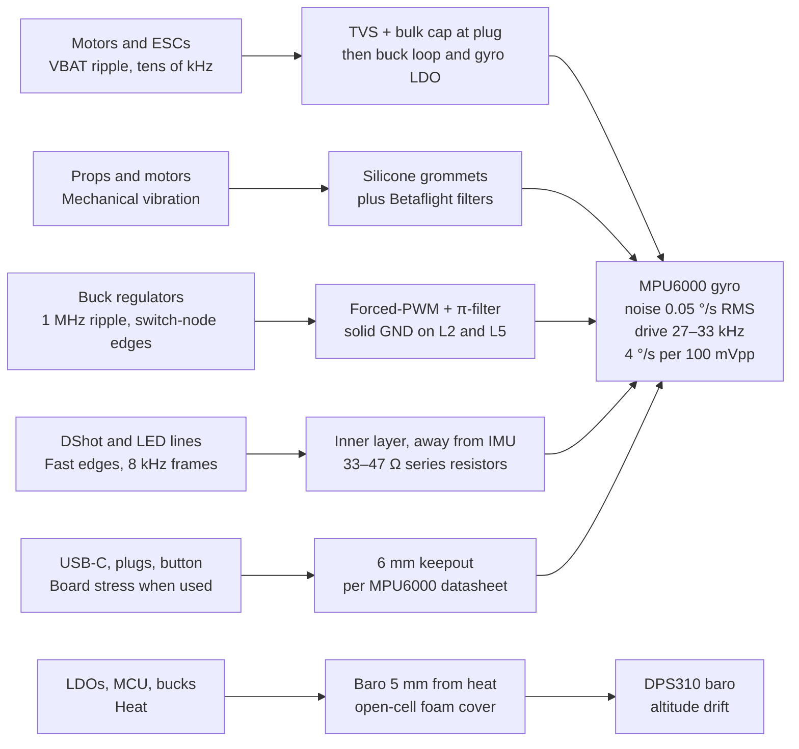

# F722 20×20 FC — Noise & EMI Review

**Reviewed against Rev A · 27 Oct 2026**

## Verdict

The design has no fatal noise path, but it is not ready for layout: 4 high-severity items and 6 medium items need fixing first. Once they are fixed, electrical noise reaching the gyro stays roughly 50× below the MPU6000's own sensor noise, and the remaining risk is vibration, which grommets and Betaflight's filters handle.

- **The number that matters:** the MPU6000 datasheet gives a supply sensitivity of 4 °/s per 100 mVpp of ripple between 250 Hz and 100 kHz, against its own noise of 0.05 °/s RMS.
- **With the fixes:** 20 mVpp of ripple on the 5 V rail, through a 60 dB LDO, leaves about 0.02 mVpp at the gyro, or roughly 0.001 °/s (scaling the datasheet figure linearly).
- **What paper can't prove:** layout coupling, ground bounce and vibration only show up on a real board. The bench tests at the end are the proof.

This review checks the [Rev A design spec](design-spec.md) against datasheets and the [3D placement](../viewer/index.html).

## Findings

Fifteen issues, ordered by severity; the high ones are spec errors or parts that won't work, not just noise risks.

| # | Severity | Area | Problem | Fix |
| --- | --- | --- | --- | --- |
| 1 | High | Gyro pins | Spec lists a VLOGIC pin and 10 nF cap. The MPU6000 has no VLOGIC; pin 8 is SPI chip select. | Drop VLOGIC. Use 0.1 µF on VDD, 0.1 µF on REGOUT, 2.2 nF 50 V on CPOUT. |
| 2 | High | Gyro footprint | Datasheet says don't solder the exposed die pad and don't route traces or vias under the package. Spec is silent. | No paste on the centre pad, no L1 traces or vias under the gyro, solid GND on L2 below it. |
| 3 | High | Buck regulators | LMR36520 is a 4.9 × 6 mm HSOIC fixed at 400 kHz, not the small part the BOM assumed. Two won't fit well on 26.5 mm. | Use LMR36015: 60 V, 1.5 A, 2 × 3 mm, 1 MHz, forced-PWM, spread spectrum. |
| 4 | High | OSD | AT7456E needs a 27 MHz crystal. It is missing from the BOM. | Add a 27 MHz crystal beside the OSD, on the side away from the gyro. |
| 5 | Medium | USB-C, BOOT | USB-C sits directly under the gyro and BOOT is about 3 mm away. Datasheet asks for 6 mm from connectors and buttons. | Re-place (see Gyro section). |
| 6 | Medium | VBAT routing | The VBAT TVS sits at the front under the gyro area, but battery enters at the rear ESC plug. | Put the TVS and input cap at the ESC plug so VBAT never crosses the front half. |
| 7 | Medium | Barometer | Baro is about 1 mm from the gyro LDO, which heats it. | Move to (−8.5, 4.5) mm, keep 5 mm from heat, cover with open-cell foam. |
| 8 | Medium | Gyro LDO | TLV75533: 71.5 µVrms noise, 46 dB PSRR at 100 kHz. | TPS7A20 3.3 V: 7 µVrms, 95 dB at 1 kHz, 60 dB at 100 kHz. |
| 9 | Medium | DShot lines | DShot frames at the 8 kHz loop rate have a 32 kHz harmonic, inside the gyro's 27–33 kHz drive band. | Route motor lines on L3, away from the gyro, 33–47 Ω series resistors at the MCU. |
| 10 | Medium | OSD supply | AT7456E is rated 3.15–5.25 V and draws about 43 mA digital. On 3V3_MCU it has 5% margin and loads the MCU rail. | Feed it through a ferrite + 10 µF, or its own LDO. 0.1 µF on each supply pin. |
| 11 | Low | Buck placement | Inductors sit about 5.6 mm from the gyro edge, breaking the spec's own 8 mm rule. | Acceptable: opposite side with 2 GND planes between. Keep the SW node small on L6, facing away. |
| 12 | Low | ADC | On LQFP64, VREF+ is tied to VDDA, so VBAT and current readings are as noisy as VDDA. | Ferrite + 1 µF + 100 nF on VDDA. 100 nF at each ADC pin. |
| 13 | Low | Analog video | Buck ripple and beat between the two bucks show as lines on video. | LC filter on camera and VTX power pads. Both bucks in forced-PWM. 0.1 µF on OSD VIN. |
| 14 | Low | Input cap | 35 V cap on 6S (25.2 V) leaves about 10 V for ESC spikes. | 50 V low-ESR cap on 6S builds. |
| 15 | Low | Buzzer | A magnetic buzzer kicks back onto 5 V when the MOSFET turns off. | Flyback diode across the buzzer pads. |

## Noise map

Five of the six paths end at the gyro; the barriers shown are the ones this design has once the findings above are fixed.

## Gyro (MPU6000)

The gyro's supply and SPI bus are sound; its pin list, footprint and neighbours need changes.

| Check | MPU6000 datasheet | Spec / 3D model | Result |
| --- | --- | --- | --- |
| Supply | VDD 2.375–3.46 V | 3.3 V from its own LDO | OK |
| Pin 8 | SPI chip select; VLOGIC exists only on MPU-6050 | Spec lists VLOGIC + 10 nF | Fix |
| Capacitors | REGOUT 0.1 µF, VDD 0.1 µF, CPOUT 2.2 nF 50 V, all X7R | REGOUT and CPOUT right, VLOGIC extra | Fix |
| SPI speed | 1 MHz for all registers, 20 MHz for sensor and interrupt reads | Same | OK |
| Exposed pad | Do not solder it; no traces or vias under the package | Not stated | Fix |
| Keepout | Connectors, buttons, shield cans at least 6 mm away | USB-C directly under, BOOT about 3 mm | Fix |
| Drive frequencies | X ≈ 33, Y ≈ 30, Z ≈ 27 kHz (±3 kHz) | DShot 32 kHz harmonic nearby | Route away |
| Power-up | VDD ramps monotonically, 10–90% within 100 ms | LDO soft-start | OK |

**Placement fix, two options:**

1. **Minimum change.** Let the USB-C overhang the front edge by 1.5 mm so it no longer sits under the gyro, and move BOOT to the rear half of the bottom. The gyro stays closer than 6 mm to USB, but USB is only plugged in on the bench, and Betaflight calibrates the gyro at power-up on battery.
2. **Full fix (best for a new layout).** Put the gyro at the board centre on top and the MCU at the bottom centre directly under it, with the L2 and L5 ground planes between them. Every edge connector is then at least 6.7 mm from the gyro edge. The bucks and OSD need a fresh placement pass.

## Power

Swap both bucks to a smaller 1 MHz forced-PWM part and give the gyro a low-noise LDO; the rest of the power tree stands.

| Rail | Was | Now | Why |
| --- | --- | --- | --- |
| 5 V buck | LMR36520, 400 kHz, 4.9 × 6 mm, 2 A | LMR36015, 1 MHz forced-PWM, 2 × 3 mm, 1.5 A | Fits the board; ripple stays far above the gyro's sensitive band |
| 10 V buck | LMR36520 | LMR36015, same settings | Same; check your VTX's peak current against 1.5 A |
| 3V3 gyro | TLV75533 | TPS7A20 3.3 V | About 10× lower noise, 14 dB more rejection at 100 kHz |
| 3V3 MCU | TLV75533 | Keep | The MCU doesn't need low noise; 500 mA leaves headroom |
| OSD supply | Straight from 3V3_MCU | Ferrite + 10 µF branch | Keeps the OSD's 43 mA bursts off the MCU rail |
| VBAT input | TVS at front, 35 V cap | TVS + cap at the ESC plug, 50 V cap on 6S | Short spike-clamping loop where the battery enters |

- **Why forced-PWM:** in auto (PFM) mode a buck skips pulses at light load, so its ripple drops into the kHz range. That lands in the 250 Hz–100 kHz band where the MPU6000 is most supply-sensitive and where analog video shows lines. Forced-PWM holds it at 1 MHz.
- **Margin:** LMR36015 runs to 60 V with 66 V transient protection, against 25.2 V for a full 6S pack.
- **Inductors:** size them from the LMR36015 datasheet's design procedure; 1 MHz needs smaller ones than the 400 kHz part did.

## Barometer

The baro has no electrical conflict with the gyro; its risks are heat, light and prop wash, and the fix is to move it to (−8.5, 4.5) mm and cover it with foam.

- **Heat:** it currently sits about 1 mm from the gyro LDO. The baro corrects pressure with its own temperature reading, so a nearby part warming up in flight shows as altitude drift. Keep it at least 5 mm from both LDOs, the MCU and the bucks.
- **Light:** pressure sensors react to light; a PX4 user traced spikes to sunlight hitting an MS5611, and the advice there is a small piece of dark open-cell foam. Open-cell matters so the pressure port isn't sealed.
- **Prop wash:** the same foam damps fast pressure changes from airflow over the board.
- **Bus:** it stays on I2C1. Keep PB8/PB9 traces off the gyro's SPI1 lines and away from under the gyro.

## Analog video, OSD and ADC

Video is the most visible victim of power noise; follow the AT7456E datasheet's coupling and grounding, filter the camera and VTX supplies, and clean up VDDA for the ADC.

**OSD (AT7456E)**

- Supply rated 3.15–5.25 V, typical 5 V. Digital current is about 43 mA typical, 60 mA max.
- 0.1 µF on each of AVDD, DVDD and PVDD to its own ground pin. Join PGND to AGND at one point; the exposed pad is AGND.
- Clock: 27 MHz crystal between CLKIN and XFB, or drive CLKIN from a 27 MHz source.
- Video in: 0.1 µF coupling capacitor on VIN.
- Video out: follow the datasheet's VOUT and SAG capacitor table, or tie SAG to VOUT if you skip sag correction.

**Camera and VTX power**

- Add an LC filter on the camera 5 V and analog VTX power pads, so buck ripple doesn't show as lines.
- Run both bucks in forced-PWM at the same 1 MHz. Two free-running converters at different frequencies can beat and show as slow rolling bars.

**ADC (VBAT, current, RSSI)**

- On the F7 LQFP64 package, VREF+ is tied to VDDA inside the chip, so any VDDA noise appears directly in the battery and current readings.
- Feed VDDA through a ferrite bead with 1 µF + 100 nF, and keep 100 nF at each ADC pin. The ESC current signal is noisy by nature, so filter it in firmware too.

## Fast signals and PCB layout

The 6-layer stackup is the design's strongest noise defence: every signal layer sits next to a solid ground plane. Keep it unbroken and keep fast lines away from the gyro.

| Signal | Risk | Rule |
| --- | --- | --- |
| DShot M1–M8 | Frames at the PID loop rate: an 8 kHz loop gives harmonics at 16, 24 and 32 kHz, near the gyro's 27–33 kHz drive | Route on L3, at least 5 mm from the gyro footprint; 33–47 Ω series resistors at the MCU to slow edges |
| LED strip, buzzer | Fast edges and current pulses on 5 V | Route along the board edge; flyback diode on the buzzer |
| SPI1 (gyro) | Its own edges at up to 20 MHz | Under 10 mm, not shared, over solid GND |
| SPI2, SPI3 (OSD, flash) | Digital noise near the gyro | Keep off the gyro's quadrant |
| I2C1 (baro, GPS compass) | Leaves the board on a GPS cable | 2.2 kΩ pull-ups near the MCU; keep off SPI1 |
| USB D+/D− | Fast edges, only on the bench | 90 Ω pair, ESD part at the connector |
| 8 MHz and 27 MHz crystals | Clock harmonics | Next to their chip, ground ring around each, away from the gyro |

- **Under the gyro:** no traces or vias on L1, solid ground on L2. The datasheet only warns against active signals on unshielded layers, so routing on L3 under L2 is acceptable but best avoided.
- **One ground:** no split planes. Stitch vias every 2–3 mm along the edges and around the gyro.
- **Vibration:** this is the biggest gyro noise source in flight, not electrical noise. Grommets reduce it; Betaflight's low-pass and dynamic notch filters remove what gets through.

## Bench tests that prove it

The gyro itself is the best noise meter: separate electrical noise from vibration by spinning motors that are not touching the board.

- [ ] **Rails:** scope the 5 V, 10 V and 3V3_GYRO rails with a short ground spring, battery connected, motors spinning without props. 3V3_GYRO should sit at the scope's noise floor; 5 V ripple should be at 1 MHz, not in kHz bursts.
- [ ] **Gyro at rest:** battery powered, motors off, board on foam. Log gyro in Blackbox; noise should be close to the datasheet's 0.05 °/s RMS.
- [ ] **Electrical-only test:** keep the board on foam and spin motors that are mounted somewhere else, wired through the ESC. Any rise in gyro noise or new spectral peak is electrical, not mechanical.
- [ ] **Full quad, props off:** spin up in the motor tab and compare spectra in Blackbox Explorer. Only motor-RPM lines should appear.
- [ ] **Video:** watch analog video while sweeping throttle. No rolling bars or lines.
- [ ] **Baro drift:** log altitude at rest for 10 minutes from a cold start. A steady climb or fall means heat is reaching the sensor.
- [ ] **VBAT and current:** compare readings to a multimeter with motors spinning; jitter should be a few counts.
- [ ] **Heat:** check bucks and LDOs after 10 minutes at full 5 V and 10 V load.

## Sources

- [MPU-6000 / MPU-6050 Product Specification](https://alliance.seas.upenn.edu/~medesign/wiki/uploads/Guides/MPU6050_datasheet.pdf) — pins, capacitors, SPI limits, noise, supply sensitivity, layout rules
- [MPU-6000 / MPU-6050 Register Map](https://forums.parallax.com/uploads/attachments/65170/100077.pdf) — MPU6000 has a single VDD supply
- [AT7456E datasheet](https://file01.andesource.com/dkpdf/AT7456E_001.pdf) — supply range, current, 27 MHz clock, video coupling
- [TI LMR36520 product page](https://www.ti.com/product/LMR36520) — 400 kHz, HSOIC 4.9 × 6 mm
- [TI LMR36520 datasheet (Chinese)](https://www.ti.com.cn/document-viewer/cn/LMR36520/datasheet/4-ZHCSKA2A) — auto and forced-PWM modes
- [TI LMR36015 product page](https://www.ti.com/product/LMR36015) — 60 V, 1.5 A, 1 MHz, spread spectrum, 2 × 3 mm
- [TI TLV755P product page](https://www.ti.com/product/TLV755P) — 71.5 µVrms, 46 dB at 100 kHz
- [TI TPS7A20 product page](https://www.ti.com/product/TPS7A20) — 7 µVrms, 95 dB at 1 kHz, 60 dB at 100 kHz
- [ST Community: VREF+ on F7 LQFP64](https://community.st.com/stm32-mcus-boards-and-hardware-tools-26/does-stm32f730r8-has-vdda-pin-or-vref-pin-lqfp64-package-27007) — VREF+ tied to VDDA
- [PX4 forum: baro sensitive to sunlight](https://discuss.px4.io/t/baro-sensor-is-sensitive-to-sunlight/3584) — light spikes, open-cell foam
- [Oscar Liang: Betaflight filters](https://oscarliang.com/filter-betaflight/) — vibration as the main gyro noise source
